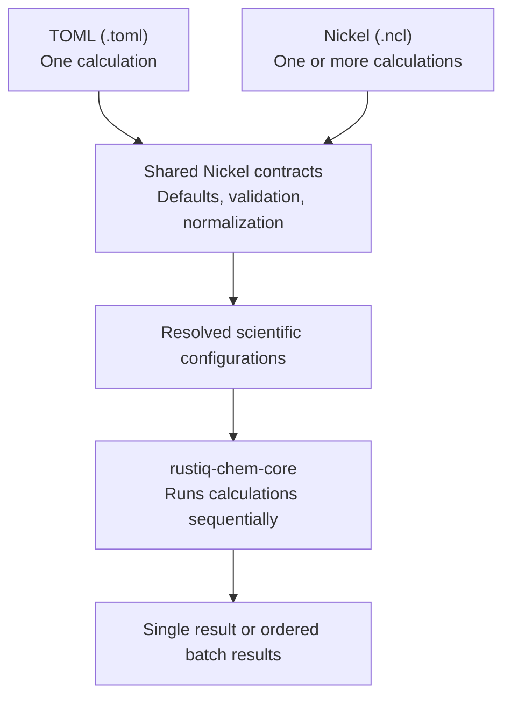

# Introduction

RustiQ is an experimental Rust quantum chemistry application and reusable
`rustiq-chem-core` library. This manual serves scientific users, Rust contributors,
and theoretical chemists.

**Do not use RustiQ results for research conclusions without independent
validation against established quantum chemistry packages.**

## Choosing a calculation input

RustiQ offers two complementary input formats. **TOML is the simple choice for one calculation**: a small, readable file is enough, and users do not need to learn Nickel.

**Nickel is optional for calculation studies.** Its imports, functions, and list operations can generate related configurations—for example, varying basis sets or numerical settings without duplicating full input files. Nickel can also describe one calculation.

Both formats pass through **the same embedded Nickel contracts** for defaults, validation, and normalization. The normalized configurations then enter the same Rust scientific core, which has no dependency on TOML or Nickel. Users do not need to install the Nickel executable: RustiQ embeds the configuration evaluator.

Choose the [TOML calculation guide](user-guide/configuration.md) for one calculation or [Nickel studies](user-guide/nickel-studies.md) for an optional parameterized campaign. **Studies execute sequentially**, not as a parallel job scheduler.

## Where should I start?

- **Scientific users:** [Installation](getting-started/installation.md) →
  [First H₂ calculation](getting-started/first-calculation.md) →
  [Interpreting output](getting-started/output.md). These explain how to run
  the software without writing Rust. Read [scientific limitations](scientific-scope.md)
  before using the results.
- **Rust developers and architects:** [Development environments](development/environments.md)
  → [Contributing, architecture, and the Rust API](development/contributing.md)
  → [Documentation checks](development/documentation.md). Start with the
  calculation lifecycle to see how input, scientific code, and reporting fit together.
  User-guide commands use the installed `rustiq` executable; a source checkout
  can install it with the instructions on the [installation page](getting-started/installation.md)
  or run it through Cargo.
- **Theoretical chemists:** [First calculation](getting-started/first-calculation.md)
  → [Reference comparisons](scientific-scope.md#reference-comparisons) →
  [Scientific limitations](scientific-scope.md#major-limitations). These identify
  tested evidence and current assumptions without requiring development tools.
  The release binary is sufficient for calculations; reproducing the reference
  suite additionally requires a source checkout and its documented test environment.

The [glossary](glossary.md) explains unfamiliar scientific and software terms.
[Existing workflow notes](reference/existing-workflows.md) preserve useful
operational guidance alongside the user guides and CLI reference.

Implemented capabilities include RHF, UHF, MP2, XYZ geometries, Gaussian basis
sets, TOML and native Nickel input, sequential studies, and versioned JSON.
The [practical user guides](user-guide/geometry.md) now cover these capabilities,
including HF/MP2 calculations, Nickel studies, JSON output, and portable
calculation bundles. The [command-line reference](reference/cli.md) describes
the shipped commands and options.

Portable `.rustiq` bundles can be written, reused, and inspected from the CLI
as well as through Rust APIs. Start with the
[portable bundle guide](user-guide/portable-bundles.md) for a runnable CLI
workflow, then see the [persistence specification](https://github.com/mveril/RustiQ/blob/main/docs/persistence-format-v1.md)
for the archive contract.
The [authoritative references](reference/index.md) page links to the roadmap
for plans and to the files that define existing contracts.
