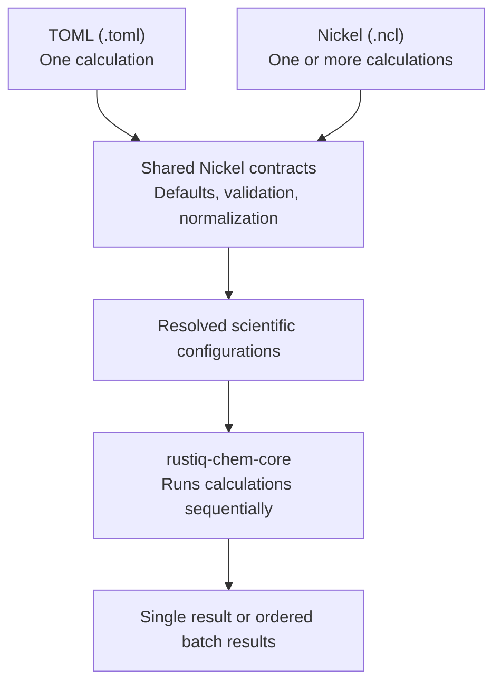

# Calculation inputs and execution

RustiQ offers two complementary input formats. **TOML is the simple choice for
one calculation**: a small, readable file is enough, and users do not need to
learn Nickel.

**Nickel is optional for calculation studies.** Its imports, functions, and
list operations can generate related configurations—for example, varying basis
sets or numerical settings without duplicating full input files. Nickel can
also describe one calculation.

Both formats pass through **the same embedded Nickel contracts** for defaults,
validation, and normalization. The normalized configurations then enter the
same Rust scientific core, which has no dependency on TOML or Nickel. Users do
not need to install the Nickel executable: RustiQ embeds the configuration
evaluator.

Choose the [TOML calculation guide](configuration.md) for one calculation or
[Nickel studies](nickel-studies.md) for a parameterized campaign. **Studies
execute sequentially**, not as a parallel job scheduler.
