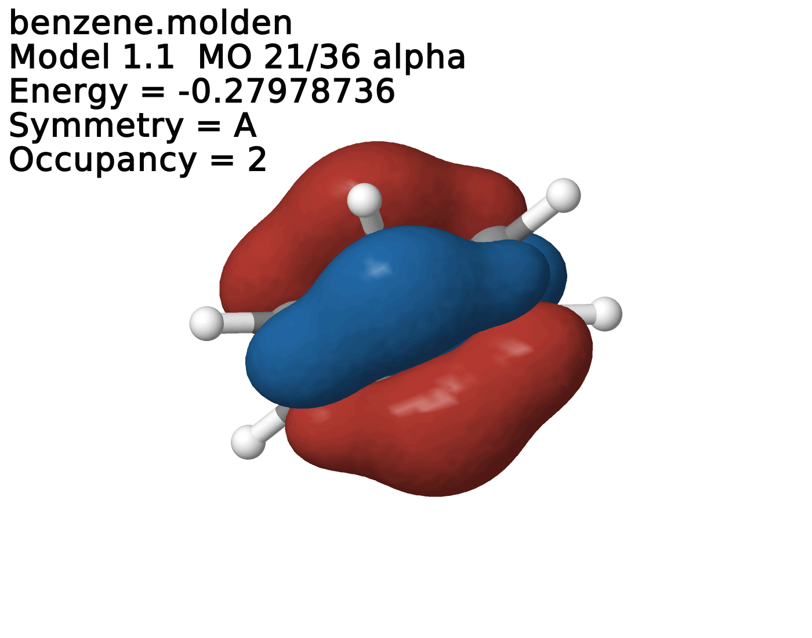
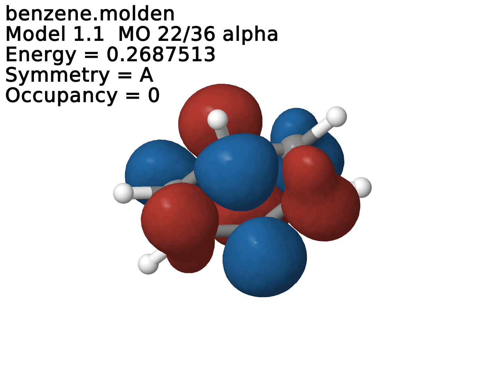
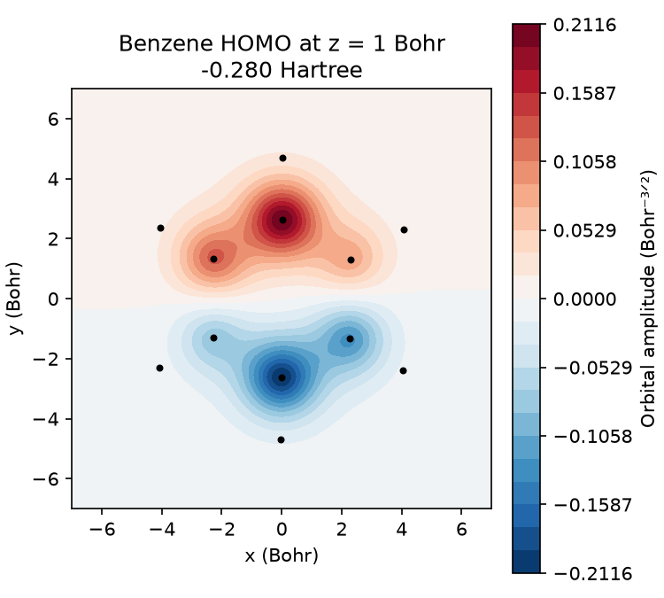

# Examples

Read this chapter in the [rendered manual](https://mveril.github.io/RustiQ/user-guide/examples.html)
to see the complete input files and scripts. The GitHub Markdown preview
shows mdBook include directives in their place.

Use the installed `rustiq` executable and save the inputs shown below in a
working directory of your choice. All three tutorials use STO-3G. Download
the complete basis once with an online build.

```sh
rustiq basis download sto-3g
```

For offline use, obtain the complete STO-3G JSON from the
[Basis Set Exchange](https://www.basissetexchange.org/) on a connected
computer, transfer it as `sto-3g.json`, and run the import from its directory.
The tutorials collectively need hydrogen, carbon, and oxygen.

```sh
rustiq basis import sto-3g.json
```

On repeat runs, choose fresh output paths or add `--force` to replace
existing bundles and Molden files. Shell redirection with `>` truncates an
existing report, so choose a new JSON filename if you want to keep it.
For failures, see [basis setup](basis-sets.md) and
[error messages and exit codes](diagnostic-codes.md).

| Example and objective | Basis | Guide and prerequisites |
| --- | --- | --- |
| Water / RHF and MP2 | STO-3G | [Reuse a saved RHF reference](#water--run-mp2-from-saved-rhf-orbitals). |
| Benzene / RHF | STO-3G | [Export molecular orbitals](#benzene--export-molecular-orbitals). |
| H₂ / RHF: first calculation | STO-3G | [First calculation](../getting-started/first-calculation.md); create the XYZ file and obtain the basis. |
| OH / UHF: open-shell calculation | STO-3G | [Inspect an unrestricted solution](#hydroxyl-radical--inspect-an-unrestricted-solution). |
| H₂ / RHF-MP2: electron correlation | STO-3G | [MP2](mp2.md); first create H₂ as in the first calculation. |
| OH / UHF-MP2: open-shell correlation | STO-3G | [Open-shell MP2](mp2.md#open-shell-uhf-mp2-example); create OH as in the HF guide. |
| Inspect and transform XYZ geometry | None | [Geometry](geometry.md); create an XYZ file. |
| Parameterized and batch studies | STO-3G and 6-31G | [Nickel studies](nickel-studies.md); obtain both bases. No separate Nickel executable is needed. |
| Create, inspect, verify and rerun bundles; reuse AO ERIs | STO-3G | [Portable bundles](portable-bundles.md); first prepare the H₂ input and basis. |

## Water — run MP2 from saved RHF orbitals

Create a directory named `h2o` with an `inputs` subdirectory. Save the
geometry as `h2o/h2o.xyz`.

```text
{{#include ../../../samples/h2o/h2o.xyz}}
```

Save the runfile as `h2o/inputs/calculation.toml`. Its geometry path resolves
relative to the TOML file, one directory up.

```toml
{{#include ../../../samples/h2o/sto-3g/calculation.toml}}
```

Save the Post-SCF settings as `h2o/postscf.toml`.

```toml
{{#include ../../../samples/h2/sto-3g/postscf.toml}}
```

The neutral singlet has five doubly occupied spatial orbitals.
`frozen_orbitals = 0` includes all five in MP2 correlation. A positive
count excludes that many of the lowest-energy occupied RHF spatial orbitals.
`memory_limit` budgets estimated additional MP2 workspace (1 GiB here).
The resident HF data and AO integrals are outside this budget. The settings
file contains only MP2 options, so you can reuse it with another compatible
HF bundle. The bundle supplies the molecule, basis, orbitals, and AO integrals.

From inside `h2o`, save and verify the converged reference, then run MP2
using that reference without repeating SCF.

```sh
rustiq run inputs/calculation.toml --artifact hf.rustiq --format json > hf.json
rustiq artifact verify hf.rustiq
rustiq run hf.rustiq --post-scf postscf.toml --artifact mp2.rustiq --format json > mp2.json
rustiq artifact verify mp2.rustiq
```

To repeat SCF from the archived input, run `rustiq run hf.rustiq`. Adding
`--post-scf postscf.toml` instead restores the converged reference for MP2.

The HF report gives a total HF energy of −74.9630631541 Hartree. The
following method record is from `calculations[0].methods[0]` in the
generated [version 1 JSON report](json-output.md).

```json
{
  "method": "mp2",
  "status": "succeeded",
  "result": {
    "reference": "RHF",
    "correlation_energy": -0.035566837117355324,
    "electronic_energy": -84.18688840870615,
    "nuclear_repulsion_energy": 9.188258417450937,
    "total_energy": -74.99862999125521
  }
}
```

The status confirms that MP2 completed with an RHF reference. Adding the
MP2 correlation energy (−0.0355668371 Hartree) to the total HF energy gives
the total MP2 energy (−74.9986299913 Hartree). Keep the portable bundle
for the scientific inputs, saved HF reference and AO integrals, and applied
MP2 settings. Keep `mp2.json` for the MP2 status and energies, and `hf.json`
for the HF report. See [portable bundles](portable-bundles.md) and
[MP2 limitations](mp2.md).

## Hydroxyl radical — inspect an unrestricted solution

Create a directory named `oh` with an `inputs` subdirectory. Save the
geometry as `oh/oh.xyz`.

```text
{{#include ../../../samples/oh/oh.xyz}}
```

Save the runfile as `oh/inputs/calculation.toml`. Its geometry path resolves
relative to the TOML file, one directory up.

```toml
{{#include ../../../samples/oh/sto-3g/calculation.toml}}
```

Neutral OH has nine electrons. Doublet multiplicity gives one more alpha
electron than beta electrons, so five are alpha and four are beta. With
`method = "Auto"`, this open-shell input selects UHF and allows the two
spin channels to have different spatial orbitals.

From inside `oh`, run HF and export the converged orbitals.

```sh
rustiq run inputs/calculation.toml --artifact hf.rustiq --format json > hf.json
rustiq artifact export hf.rustiq --format molden -o oh.molden
```

The total HF energy is −74.3626692217 Hartree. In the JSON report,
`calculation.hf.spin.s_squared` is 0.75326194, about 0.00326 above the ideal
doublet value of 0.75. This excess is spin contamination, indicating a
small contribution from higher-spin components in the UHF determinant.
SCF convergence measures numerical self-consistency and does not guarantee
a spin eigenstate. See [Hartree–Fock diagnostics](hartree-fock.md).

Under `[MO]` in `oh.molden`, each orbital has a `Spin= Alpha` or
`Spin= Beta` label. Count five alpha and four beta records with occupation
1. The virtual orbitals in each channel have occupation 0.

## Benzene — export molecular orbitals

Create a directory named `benzene` with an `inputs` subdirectory. Save the
geometry as `benzene/benzene.xyz`.

```text
{{#include ../../../samples/benzene/benzene.xyz}}
```

Save the runfile as `benzene/inputs/calculation.toml`. Its geometry path resolves
relative to the TOML file, one directory up.

```toml
{{#include ../../../samples/benzene/sto-3g/calculation.toml}}
```

Benzene needs both carbon and hydrogen in its STO-3G basis. From inside
`benzene`, run RHF and export the converged orbitals.

```sh
rustiq run inputs/calculation.toml --artifact hf.rustiq --format json > hf.json
rustiq artifact export hf.rustiq --format molden -o benzene.molden
```

The total RHF energy is −227.8908322166 Hartree. Neutral benzene has
42 electrons, giving 21 doubly occupied spatial orbitals. In the Molden
file these have occupation 2, and the 15 virtual orbitals have occupation 0.
Read the frontier energies in Hartree from the `Ene=` fields in
`benzene.molden`. Jmol numbers these records starting at 1.

| Molden record | Orbital | Occupation | Energy (Hartree) |
| ---: | --- | ---: | ---: |
| 20 | HOMO−1 | 2 | −0.27982092 |
| 21 | HOMO | 2 | −0.27978734 |
| 22 | LUMO | 0 | 0.26875127 |
| 23 | LUMO+1 | 0 | 0.26879226 |

The RHF orbital gap, ε(LUMO) − ε(HOMO), is 0.54853861 Hartree.
Experimental excitation energies are differences between many-electron
states and include effects outside this orbital-energy difference.
Ideal hexagonal benzene (D₆h) has a doubly degenerate frontier pair on
each side of the gap. The supplied coordinates approximate this symmetry.
The occupied pair splits by about 3.36 × 10⁻⁵ Hartree and the virtual pair
by about 4.10 × 10⁻⁵ Hartree. The exported symmetry labels are placeholders.
See [Molden export](portable-bundles.md#export-orbitals-to-molden).

### Render the frontier orbitals in Jmol

The surfaces in each figure mark opposite signs of the orbital amplitude,
with red for negative and blue for positive. An orbital's overall sign
is arbitrary. Within an exactly degenerate subspace, rotations give equally
valid canonical orbitals. With a small energy splitting, the canonical
orbitals can still be sensitive to small geometry changes.



*Benzene HOMO (MO 21), RHF/STO-3G. Jmol 16.5.7, orbital amplitude
isosurfaces at ±0.04 Bohr⁻³ᐟ².*



*Benzene LUMO (MO 22), RHF/STO-3G. Jmol 16.5.7, orbital amplitude
isosurfaces at ±0.04 Bohr⁻³ᐟ².*

Install Java, download the [Jmol 16.5.7 binary archive](https://sourceforge.net/projects/jmol/files/Jmol/Version%2016.5/Jmol%2016.5.7/),
and extract `Jmol.jar`. The figures were generated with Java 21.0.13.1
on Linux. Save the script as `benzene/plot_molden_jmol.spt`, beside
`benzene.molden`.

```text
{{#include ../../../samples/benzene/plot_molden_jmol.spt}}
```

From inside `benzene`, run the command below with the path to your Jmol
JAR. Use a graphical desktop session or a virtual display on Linux.

```sh
java -jar /path/to/Jmol.jar -n -x -s plot_molden_jmol.spt
```

The script loads the Molden file, sets the same camera and colors for
both views, selects orbitals 21 and 22, and writes
`benzene-homo-jmol.png` and `benzene-lumo-jmol.png` at 1400 × 1100 pixels.
Jmol 16.5.7 preserves the orbital energy values and leaves their units
unlabeled. Read them in Hartree using the Molden export and table above.

### Optional orbital slice with PySCF

Save the following script as `benzene/plot_molden.py`.

```python
{{#include ../../../samples/benzene/plot_molden.py}}
```

From inside `benzene`, use Python 3 to create an isolated environment.
These commands use a POSIX shell. On Windows, use
`.venv\Scripts\python.exe` in place of `.venv/bin/python`.

```sh
python -m venv .venv
.venv/bin/python -m pip install numpy pyscf matplotlib
.venv/bin/python plot_molden.py benzene.molden benzene-homo.png
```

PySCF reads the exported orbitals and the script plots the HOMO in the
plane `z = 1 Bohr`, about 1 Bohr above the ring. Open the PNG in an image
viewer. The colors mark opposite signs of the orbital amplitude and the
dots show projected atomic positions.



## Contributor reproduction and reference checks

From a source checkout, you can use the files in `samples/h2o`,
`samples/oh`, and `samples/benzene` directly. The method-only input is
`samples/h2/sto-3g/postscf.toml`. Use the installed executable or substitute
`cargo run --locked --` from the repository root.

The split-run integration test checks that fresh and restored water
STO-3G MP2 energies agree within 10⁻¹² Hartree. Separate PySCF checks cover
water STO-3G RHF (3 × 10⁻⁸ Hartree), water MP2 with 6-31G and cc-pVDZ,
and OH STO-3G UHF (5 × 10⁻⁸ Hartree for total energy and 2 × 10⁻⁵
for ⟨S²⟩). The reference suite does not include water STO-3G MP2 or
benzene.

```sh
cargo test --locked --test artifact_cli post_scf_split_run_matches_full_mp2_calculation
uv run --locked pytest tools/reference/test_compare_pyscf.py -k 'h2o or oh-sto-3g-uhf'
```

Report scientific discrepancies through the [issue tracker](https://github.com/mveril/RustiQ/issues).
Include the RustiQ version, input and geometry, basis source, observed and
expected results, comparison method, and units. Use the same tracker for
feature requests and workflow feedback.
